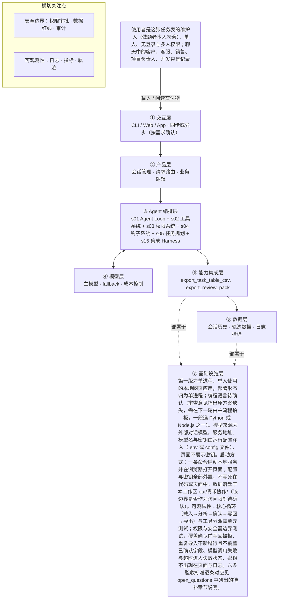

# PRD 推导方案 ——「青禾协作——根据聊天记录更新任务表」

> 状态：方案待确认（审稿未完全通过，见文末审稿意见）（Step 1–4 已完成，Step 5 代码生成需确认后启动）
> 推导引擎：Agent Blueprint · 模型：anthropic

## 产品定位（一句话）

**青禾协作——根据聊天记录更新任务表**：给任务表维护人用：把聊天记录里散落的客户诉求与负责人决定，经外部对话模型分析成可核对的字段级建议，逐条确认后再写回任务表并导出，免去从聊天里重推当前安排。

## ⚠️ 待确认清单（答不上就是风险点）

1. 产品目标的可度量指标是什么：完成率、建议准确率、单次分析时延、模型调用成本各自的目标值是多少？
2. 维护人的使用频率如何，一次分析预期耗时多久，是否允许异步等待或需要进度提示以外的等待方式？
3. 单次会话是否需跨批次延续（例如 A 批的确认状态如何带入 B 批），还是完全依靠导出的任务表作为唯一状态载体？
4. 可接受的数据边界：处理材料是否只限本工作区内 CSV，是否允许含真实客户或隐私数据？
5. 第 8 节五处未拍板项（A-08 是否新增、W-01 当前安排、W-02 验收条件、W-03 是否完成、W-04 是否完成澄清）在 PRD 中按未决处理还是等拍板后补入第 6 节？
6. 失败降级策略细节：模型返回格式不合法、依据无法指回聊天编号、超时或密钥缺失时，建议区如何呈现、是否允许部分重试？
7. 导出任务表与建议清单的具体文件格式（列集、编码、命名、是否含变更说明独立成文件）由谁定？
8. 成功标准口径：原始需求成功表述为「维护人打开任务表看见已确认的安排」，三样产物是「跑完一次留下的东西」；方案按产物齐全性设计可度量指标，是否将产物齐全作为成功标准的组成部分待确认。
9. 交互是否同步式：原始输入只写使用者主动发起分析、页面能区分处理中／完成／失败，未规定同步或异步，标为待确认。
10. 数据访问边界：工作区 out/青禾协作/ 在原始输入中是产物落盘位置，未规定程序不得读取其他路径，是否作为数据访问约束待确认。
11. 模型调用额度：原始输入有「这次检查是模拟，不把额度打尽」的额度相关表述，时延、并发、成本与额度上限均待确认。
12. 多人访问策略：原始输入只说不做登录、多人权限、按角色分账号，未要求「默认拒绝他人访问」的实现策略，待确认。
13. 子 Agent（s06）、上下文压缩（s08）、记忆系统（s09）、任务系统（s10）、后台任务（s11）均为待确认；待确认期间第一版默认不启用，以单 Agent Loop + 导出物作为状态载体，后续若确认再纳入。
14. 原始输入第 8 节 5 处未拍板项需在 PRD 前消化：A-08 页面不顺、W-01 当前安排、W-02 验收条件、W-03 是否完成、W-04 是否完成澄清；方案未写死这些结论。
15. 六条验收标准需在方案中逐条对应章节：产品闭环、可部署（一条命令启动与配置外置）、可容错（失败与超时降级路径）、可度量（成功指标与采集方式）、可测试（核心循环与工具分派单测、权限与安全边界测试）、可核对（建议清单与变更说明的追溯），当前仅在 tech_stack_and_deployment 与 observability 中分散覆盖，需补齐对应关系。
16. 编程语言与具体框架选型待确认。
17. 【组件 s06 子 Agent】是否会出现上下文爆炸的子任务，或可并行的探索型子任务？
18. 【组件 s08 上下文压缩】会话是否很长、工具输出或日志量是否很大？
19. 【组件 s09 记忆系统】是否需要跨会话记住用户偏好、决策、历史？
20. 【组件 s10 任务系统】目标是否需要持久化、支持断点续跑？
21. 【组件 s11 后台任务】是否有耗时几分钟以上的慢操作需要不阻塞主流程？

## Step 1 · 需求拆解（提取硬事实）

| 维度 | 结论 | 状态 | 出处 |
|---|---|---|---|
| 目标 | 维护人打开任务表即可看见已确认的安排，不用再从聊天里重推一遍；成功标准为一次跑完留下三样东西：更新后的完整任务表、仍可核对的建议清单、变更说明。 | 明确 | 成功时，维护人打开任务表就能看见已经确认的安排，不用从聊天里重推一遍。／跑完一次，留下三样东西：更新后的完整任务表、仍可核对的建议清单、变更说明。 |
| 用户 | 使用者是这张任务表的维护人（做题者本人扮演），单人、无登录与多人权限；聊天中的客户、客服、销售、项目负责人、开发只是记录来源，不是网页账号；交互为使用者主动发起分析的同步式网页操作。使用频率待确认。 | 明确 | 使用者是这张任务表的维护人。做题的人自己扮演这个角色。／聊天里的客户、客服、销售、项目负责人、开发，是记录来源，不是网页账号。／登录、多人权限、按角色分账号（不做） |
| 核心闭环 | 上传任务表 CSV 与一批聊天记录 CSV → 页面显示读入内容 → 使用者主动发起分析，程序真实调用外部对话模型产出字段级建议（原值、建议值、依据原话、不确定点）→ 使用者逐条采纳／否决／修改后采纳 → 导出完整新任务表与变更说明 → 以导出表为现有表载入下一批，重复 R1–R5；同一批相同编号相同正文重复导入不得新增行、不得覆盖已确认字段。 | 明确 | 只有一条连续场景：1. 载入初始工作清单和 A 批，分析、核对、确认、导出。2. 用导出的任务表加上 B 批，再走一遍，再导出。3. 把同一批、相同编号、相同正文再导入一次。结果不得多出一行，也不得破坏已经确认的字段。 |
| 交付物 | 三样产物：更新后的完整任务表（CSV，可再次作为现有任务表载入）、仍可核对的建议清单（每条含任务编号、字段名、原值、建议值或「不建议修改」、聊天编号与原话、不确定点、使用者决定）、变更说明（改了什么、依据哪句原话、还缺什么，未改行也能说明保持原安排）。 | 明确 | 跑完一次，留下三样东西：更新后的完整任务表、仍可核对的建议清单、变更说明。变更说明写清改了什么、依据是哪句原话、还缺什么。没改的行也要能说明保持原安排。 |
| 边界 | 不做：登录、多人权限、按角色分账号；接入真实聊天软件或自动收消息；复杂历史系统与公网部署；让业务使用者从聊天工具手抄答案进网页；把三份附件的处理结论写死在程序里；程序代替使用者确认。另外不得预写答案、不得用纯规则替代模型分析、不得把别处生成的答案粘进网页；PRD 不出现提交清单、打包文件名、候选人姓名、密钥、考试平台地址、命令行工具选型。 | 明确 | 3.2 不做：登录、多人权限、按角色分账号／接入真实聊天软件，或自动收消息／复杂历史系统、公网部署／让业务使用者把答案从聊天工具抄进网页／把这三份附件的处理结论写死在程序里／程序代替使用者确认。／不能预写答案、用纯规则替代分析，或把别处生成的答案粘进网页。 |
| 约束 | 分析必须真实调用外部对话模型，服务地址、模型名与密钥由运行配置注入，页面不展示密钥，调用失败时页面不得显示分析成功且已确认的任务表与决定仍保留、配置恢复后可重试；CSV 为 UTF-8 带 BOM；模型调用时延、并发、成本上限待确认；数据仅限本工作区 out/青禾协作/；材料为虚构团队，日期为虚构项目日历。 | 明确 | 分析由外部对话模型完成；服务地址、模型名和密钥由运行配置注入；页面不展示密钥；失败时进入失败状态。分析必须真实调用模型。／CSV 为 UTF-8，带 BOM。／模型调用失败时，页面不显示分析成功。已经确认的任务表和已经作出的决定还在。配置恢复后可以重试。／工作区 out/青禾协作/ |

## Step 2 · 领域建模（映射 Harness 五要素）

| 要素 | 内容 |
|---|---|
| **工具** | 读取上传的任务表 CSV 与聊天记录 CSV，作为分析输入；真实调用外部对话模型，对每个任务字段产出字段级建议；导出更新后的完整任务表 CSV（UTF-8 带 BOM，可再次作为现有任务表载入）；导出仍可核对的建议清单与变更说明 |
| **知识** | 字段级建议的业务依据来自聊天记录 CSV 中的原话，每条建议需附聊天编号与原话；变更说明依据领域规则：改了什么、依据哪句原话、还缺什么，未改行说明保持原安排；任务表字段 schema（任务编号、字段名、原值等）来自上传的任务表 CSV |
| **观察** | 页面显示读入的任务表与聊天记录内容，供使用者核对已载入的数据；建议清单逐条展示原值、建议值或「不建议修改」、依据原话、不确定点与使用者决定，仍可核对；模型调用失败时页面进入失败状态，不显示分析成功；重复导入同一批相同编号相同正文后，检查不新增行、已确认字段未被覆盖 |
| **行动** | 使用者通过同步式网页上传 CSV 并主动发起分析；使用者逐条采纳、否决或修改后采纳建议；分析通过外部对话模型服务地址与模型名调用，密钥由运行配置注入且页面不展示；配置恢复后由使用者在页面上重试分析 |
| **权限** | 程序不得代替使用者确认，所有字段变更需使用者逐条采纳后才生效；密钥仅由运行配置注入，页面不展示，属于不可暴露数据；数据仅限本工作区 out/青禾协作/，不得访问该范围之外的数据；不接入真实聊天软件、不自动收消息，无登录与多人权限，按单人使用默认拒绝他人访问 |

## Step 3 · 组件选型（宁可少选）

| 组件 | 选否 | 理由 | 参考 |
|---|---|---|---|
| s01 Agent Loop | ✅ 必选 | 一切基础：循环 + 工具（一切基础，恒选） | s01_agent_loop/README.md |
| s02 工具系统 | ✅ 必选 | 需要调用外部系统/API/数据源（一切基础，恒选） | s02_tool_use/README.md |
| s03 权限系统 | ✅ 必选 | 采纳建议会写回并覆盖任务表的责任人、截止日、验收条件等已确认字段，属于对外部（任务表）的写入操作，规则第 9 条明确「使用者确认之前，任务表不变」。 | s03_permission/README.md |
| s04 钩子系统 | ✅ 必选 | 要求每条建议给出原值、建议值、依据原话并指回聊天编号，留下仍可核对的建议清单与变更说明，实质是决策留痕与可追溯记录。 | s04_hooks/README.md |
| s05 任务规划 | ✅ 必选 | 连续场景是载入→分析→核对→确认→导出→载入下一批再走一遍，使用者逐条决定、部分字段更新、失败可重试，属于多轮推进与状态跟踪，而非固定顺序调用几个工具。 | s05_todo_write/README.md |
| s06 子 Agent | ❓ 待确认 | 输入未说明：是否会出现上下文爆炸的子任务，或可并行的探索型子任务？ | s06_subagent/README.md |
| s07 技能加载 | ❌ 放弃 | 领域知识仅为第 5 节十条业务规则与字段定义，输入未描述需要按需加载的庞大知识库。 | s07_skill_loading/README.md |
| s08 上下文压缩 | ❓ 待确认 | 输入未说明：会话是否很长、工具输出或日志量是否很大？ | s08_context_compact/README.md |
| s09 记忆系统 | ❓ 待确认 | 输入未说明：是否需要跨会话记住用户偏好、决策、历史？ | s09_memory/README.md |
| s10 任务系统 | ❓ 待确认 | 输入未说明：目标是否需要持久化、支持断点续跑？ | s10_task_system/README.md |
| s11 后台任务 | ❓ 待确认 | 输入未说明：是否有耗时几分钟以上的慢操作需要不阻塞主流程？ | s11_background_tasks/README.md |
| s12 定时调度 | ❌ 放弃 | 明确要求使用者主动发起分析，且不做自动收消息、接入真实聊天软件，产品闭环为人工触发。 | s12_cron_scheduler/README.md |
| s13 Agent 团队 | ❌ 放弃 | 使用者为单一维护人，产品为单人单表串行流程，无多 Agent 团队或隔离工作区需求。 | s13_agent_teams/README.md |
| s14 MCP 插件 | ❌ 放弃 | 不做接入真实聊天软件或自动收消息，外部依赖仅为运行配置注入的外部对话模型服务，未提 MCP 或第三方插件生态。 | s14_mcp_plugin/README.md |
| s15 集成 Harness | ✅ 必选 | 第一版已选 3 个可选组件（s03, s04, s05），需归一到单一循环 | s15_integrated_harness/README.md |
| s16 工作流运行时 | ❌ 放弃 | 虽有三步连续场景，但流程含模型临场判断（判断哪条聊天对应哪条任务、哪个字段、是否待核实）与使用者逐条决定分支，不属于无需模型决策的固定阶段序列。 | s16_workflow_runtime/README.md |
| s17 目标闭环 | ❌ 放弃 | 完成与否由使用者逐条采纳／否决／修改后采纳决定，规则第 9 条「使用者确认之前，任务表不变」，明确不由程序自动判定完成。 | s17_goal_loop/README.md |

特征判定依据：

- `destructive_ops` = yes：采纳建议会写回并覆盖任务表的责任人、截止日、验收条件等已确认字段，属于对外部（任务表）的写入操作，规则第 9 条明确「使用者确认之前，任务表不变」。
- `audit_needed` = yes：要求每条建议给出原值、建议值、依据原话并指回聊天编号，留下仍可核对的建议清单与变更说明，实质是决策留痕与可追溯记录。
- `multi_step` = yes：连续场景是载入→分析→核对→确认→导出→载入下一批再走一遍，使用者逐条决定、部分字段更新、失败可重试，属于多轮推进与状态跟踪，而非固定顺序调用几个工具。
- `context_heavy` = unknown：单批仅 A 批 10 条、B 批 6 条聊天，输入未说明是否存在上下文爆炸或可并行的探索型子任务。
- `large_knowledge` = no：领域知识仅为第 5 节十条业务规则与字段定义，输入未描述需要按需加载的庞大知识库。
- `long_sessions` = unknown：输入未说明单次会话长度、模型输出或日志规模；批次数据量很小但会话是否跨批次延续未定义。
- `cross_session_memory` = unknown：输入只要求同一批重复导入不覆盖已确认字段、导出表可再次载入，未说明是否需跨会话记住用户偏好或历史决策，跨会话记忆与批次间状态延续的界线待确认。
- `persistent_goals` = unknown：输入要求「用导出的任务表加上 B 批，再走一遍」，但未说明分析任务是否需中途持久化与断点续跑。
- `slow_operations` = unknown：输入要求真实调用外部对话模型并区分处理中／完成／失败，但未给出单次分析耗时量级，是否达分钟级待确认。
- `scheduled` = no：明确要求使用者主动发起分析，且不做自动收消息、接入真实聊天软件，产品闭环为人工触发。
- `parallel_isolated` = no：使用者为单一维护人，产品为单人单表串行流程，无多 Agent 团队或隔离工作区需求。
- `external_ecosystem` = no：不做接入真实聊天软件或自动收消息，外部依赖仅为运行配置注入的外部对话模型服务，未提 MCP 或第三方插件生态。
- `fixed_orchestration` = no：虽有三步连续场景，但流程含模型临场判断（判断哪条聊天对应哪条任务、哪个字段、是否待核实）与使用者逐条决定分支，不属于无需模型决策的固定阶段序列。
- `auto_completion` = no：完成与否由使用者逐条采纳／否决／修改后采纳决定，规则第 9 条「使用者确认之前，任务表不变」，明确不由程序自动判定完成。

## Step 4 · 架构设计

### 分层架构图（7 层 + 数据流）



| 层 | 名称 | 回答的问题 | 落地锚点 |
|---|---|---|---|
| ① | 交互层 | 谁在用、怎么用？ | CLI / Web / App / API；同步或异步；人机比 |
| ② | 产品层 | 产品外壳是什么？ | 会话管理、请求路由、账户、业务逻辑 |
| ③ | Agent 编排层 | Harness 如何运转？ | loop、工具分发、hooks、权限、记忆、任务、技能、压缩、子 agent / 团队、目标闭环 |
| ④ | 模型层 | 智能从哪来？ | 主模型、辅助模型、路由、fallback、成本 |
| ⑤ | 能力集成层 | 如何触达外部世界？ | 内部工具、MCP server、知识库、第三方 API |
| ⑥ | 数据层 | 什么需要持久化？ | 记忆、任务、会话历史、轨迹数据、日志指标 |
| ⑦ | 基础设施层 | 如何部署运行？ | 单进程 / 服务 / 团队、沙箱、队列、调度、监控 |

### 工具清单

| 工具 | 输入 | 输出 | 副作用 | 权限 | 归属层 |
|---|---|---|---|---|---|
| `load_task_table_csv` | 使用者上传的任务表 CSV（UTF-8 带 BOM），可为首次载入的初始工作清单，也可为上一次导出的更新后任务表 | 解析后的任务表记录：任务编号、各字段名与当前原值，以及已确认字段与使用者既往决定的标记 | 仅读入内存与页面展示，不修改已载入数据 | allow | ② |
| `load_chat_csv` | 使用者上传的一批聊天记录 CSV（UTF-8 带 BOM） | 解析后的聊天记录条目：聊天编号、发言方、正文、时间等原始字段 | 仅读入内存与页面展示，不接入真实聊天软件、不自动收消息 | allow | ② |
| `analyze_fields_with_llm` | 已载入的任务表记录与聊天记录条目 | 字段级建议集合，每条含任务编号、字段名、原值、建议值或「不建议修改」、依据聊天编号与原话、不确定点 | 真实调用外部对话模型，服务地址、模型名与密钥由运行配置注入且页面不展示；不写回任务表 | ask | ③ |
| `record_user_decision` | 使用者对某条建议的决定：采纳／否决／修改后采纳，及修改后的值 | 带决定的建议条目：任务编号、字段名、原值、建议值、依据原话、不确定点、使用者决定 | 记录决定本身；此步不改变任务表字段值 | ask | ④ |
| `apply_confirmed_changes` | 使用者已采纳或修改后采纳的建议条目与当前任务表记录 | 更新后的完整任务表记录，含每条变更的来源建议标识 | 按使用者决定写回任务表字段；使用者确认之前任务表不变；程序不得代替使用者确认 | ask | ④ |
| `export_task_table_csv` | 更新后的完整任务表记录 | 更新后的完整任务表 CSV（UTF-8 带 BOM），可再次作为现有任务表载入 | 在工作区 out/青禾协作/ 下写出任务表文件 | allow | ⑤ |
| `export_review_pack` | 带决定的建议条目集合与变更明细 | 仍可核对的建议清单与变更说明：改了什么、依据哪句原话、还缺什么；未改行说明保持原安排 | 在工作区 out/青禾协作/ 下写出建议清单与变更说明文件 | allow | ⑤ |

### 系统提示词草案

```
你是「青禾协作」任务表更新助手，服务对象是任务表的单一维护人。
身份与目标：把聊天记录里散落的客户诉求与负责人决定，分析成可核对的字段级建议，供维护人逐条确认后写回任务表。
规则：
1. 只依据已载入的任务表 CSV 与聊天记录 CSV 作答；每条建议必须附聊天编号与原话，找不到依据就标「不建议修改」并写明缺什么，不得编造任务编号、字段值或原话。
2. 分析必须由你真实完成，不得用纯规则替代，不得预写答案或粘贴别处生成的答案。
3. 不得代替维护人确认；未经其采纳，任务表不变。
4. 你只输出建议与不确定点，写回与导出交由工具在维护人确认后执行。
5. 不接入真实聊天软件、不自动收消息；不展示任何密钥。
6. 载入与导出限于本工作区 out/青禾协作/（该边界待确认）。
工具说明：载入任务表与聊天 CSV；按字段产出建议（原值、建议值或「不建议修改」、依据原话、不确定点）；记录采纳／否决／修改后采纳；确认后写回并导出任务表、建议清单与变更说明。
知识目录：任务表字段 schema（来自上传 CSV）；聊天原话为唯一依据来源；变更说明须写清改了什么、依据哪句原话、还缺什么，未改行说明保持原安排。
```

### 上下文与记忆策略

会话内：以「当前任务表记录 + 本批聊天记录 + 已产生的建议与决定」为工作上下文，建议逐条携带聊天编号与原话引用，供使用者核对与后续变更说明引用。跨会话不持久化模型对话历史，而是以导出物为记忆载体：下一批（B 批）开始时重新载入上一次导出的更新后任务表 CSV 与建议清单，其中已确认字段与既往决定标记随文件带入，写回前逐条比对任务编号与原值，原值已变或已标记确认的字段不得覆盖，并在建议清单中标为保持原安排，以此保证「不覆盖已确认字段」可核对；不使用跨会话记忆系统（是否启用待确认）。

### 安全边界与降级策略

- 未经使用者确认的写回请求 → apply_confirmed_changes 权限设为 ask 并校验逐条决定，缺决定即拒绝，任务表保持不变。
- 工具失败（CSV 解析失败或导出写入失败）→ 页面进入失败状态，不显示分析成功；已确认的任务表与已作出的决定保留，修正输入后可重试。
- 模型调用失败或返回不可解析结果 → 该批次建议置为失败态并展示失败原因，不产生任何字段变更；配置恢复后由使用者在页面重试。
- 模型幻觉（建议值无原话依据或任务编号／字段名不存在于任务表）→ 该条建议标记「待核实」并不进入可采纳状态；建议清单保留原话引用供人工比对。
- 超时 → 即使时延上限待确认，保守路径为：超时即判为失败状态，不写回、不导出，保留已有决定与任务表，页面提示可重试；不自动无限重试。
- 越权访问（试图读写工作区 out/青禾协作/ 之外的数据或读取密钥）→ 拒绝该操作并在页面提示；密钥仅由运行配置注入、页面与日志均不展示。
- 重复导入同一批相同编号、相同正文的聊天记录 → 按任务编号与正文去重，不新增行、不覆盖已确认字段，并在建议清单中标明「已处理，保持原安排」。
- 额度保护 → 按最小必要批次调用模型，不在单次分析中重复调用同一批内容；额度耗尽即进入失败状态并可重试（额度上限待确认）。

### 可观测性

- 日志：每次载入任务表与聊天记录：文件名、任务行数、聊天条数、去重命中条数；每次模型调用：批次标识、模型名（不记密钥）、耗时、成功或失败及失败原因；每次使用者决定：任务编号、字段名、采纳／否决／修改后采纳、决定时间；每次写回与导出：变更字段清单、导出文件路径、重复导入时被跳过的条目
- 指标：与 PRD 成功标准对齐：三样产物齐全率（更新后任务表、建议清单、变更说明各为 1 份且可打开核对）；建议可核对率：含聊天编号与原话引用的建议条数 ÷ 建议总条数（对齐「仍可核对」）；重复导入幂等率：重复导入后新增行数为 0 的批次占比（对齐「不得多出一行」）；已确认字段保护率：重复导入后已确认字段值未变更的字段数 ÷ 已确认字段总数（对齐「不破坏已确认字段」）；模型调用失败率与超时率，按批次统计并关联失败状态展示
- 轨迹：按批次（A 批、B 批、重复导入批）记录一条轨迹：载入 → 分析调用 → 逐条决定 → 写回 → 导出，每步记录入参摘要、工具名、结果状态与对应的任务编号／聊天编号，供事后复现与核对。

### 技术栈与部署形态

第一版为单进程、单人使用的本地网页应用，部署形态归为单进程；编程语言待确认（审查意见指出原方案缺失，需在下一轮由主流程拍板，一般选 Python 或 Node.js 之一）。模型来源为外部对话模型，服务地址、模型名与密钥由运行配置注入（.env 或 config 文件），页面不展示密钥。启动方式：一条命令启动本地服务并在浏览器打开页面；配置与密钥全部外置，不写死在代码或页面中。数据落盘于本工作区 out/青禾协作/（该边界是否作为访问限制待确认）。可测试性：核心循环（载入→分析→确认→写回→导出）与工具分派需单元测试；权限与安全需边界测试，覆盖确认前写回被拒、重复导入不新增行且不覆盖已确认字段、模型调用失败与超时进入失败状态、密钥不出现在页面与日志。六条验收标准逐条对应见 open_questions 中列出的待补章节说明。

## 验收标准对照（可落地 vs demo）

| 标准 | 要求 | 本方案的对应设计 |
|---|---|---|
| 可运行 | 一条命令能起，配置与密钥外置（.env / config） | 第一版为单进程、单人使用的本地网页应用，部署形态归为单进程；编程语言待确认（审查意见指出原方案缺失，需在下一轮由主流程拍板，一般选 Python 或 Node.js 之一）。模型来源为外部对话模型，服务地址、模型名与密钥由运行配置注入（.env 或 config 文件），页面不展示密钥。启动方式：一条命令启动本地服务并在浏览器打开页面；配置与密钥全部外置，不写死在代码或页面中。数据落盘于本工作区 out/青禾协作/（该边界是否作为访问限制待确认）。可测试性：核心循环（载入→分析→确认→写回→导出）与工具分派需单元测试；权限与安全需边界测试，覆盖确认前写回被拒、重复导入不新增行且不覆盖已确认字段、模型调用失败与超时进入失败状态、密钥不出现在页面与日志。六条验收标准逐条对应见 open_questions 中列出的待补章节说明。 |
| 可容错 | 工具失败、模型幻觉、超时、越权都有明确降级路径 | 未经使用者确认的写回请求 → apply_confirmed_changes 权限设为 ask 并校验逐条决定，缺决定即拒绝，任务表保持不变。；工具失败（CSV 解析失败或导出写入失败）→ 页面进入失败状态，不显示分析成功；已确认的任务表与已作出的决定保留，修正输入后可重试。；模型调用失败或返回不可解析结果 → 该批次建议置为失败态并展示失败原因，不产生任何字段变更；配置恢复后由使用者在页面重试。 |
| 可观测 | 有日志、有指标、有轨迹数据 | 每次载入任务表与聊天记录：文件名、任务行数、聊天条数、去重命中条数；每次模型调用：批次标识、模型名（不记密钥）、耗时、成功或失败及失败原因；与 PRD 成功标准对齐：三样产物齐全率（更新后任务表、建议清单、变更说明各为 1 份且可打开核对）；建议可核对率：含聊天编号与原话引用的建议条数 ÷ 建议总条数（对齐「仍可核对」） |
| 可测试 | 核心循环与工具分派有单测，权限与安全有边界测试 | Step 5 骨架层需附核心循环与权限边界的单测 |
| 可部署 | 有明确的部署形态（单进程 / 服务 / 团队）与启动文档 | 第一版为单进程、单人使用的本地网页应用，部署形态归为单进程；编程语言待确认（审查意见指出原方案缺失，需在下一轮由主流程拍板，一般选 Python 或 Node.js 之一）。模型来源为外部对话模型，服务地址、模型名与密钥由运行配置注入（.env 或 config 文件），页面不展示密钥。启动方式：一条命令启动本地服务并在浏览器打开页面；配置与密钥全部外置，不写死在代码或页面中。数据落盘于本工作区 out/青禾协作/（该边界是否作为访问限制待确认）。可测试性：核心循环（载入→分析→确认→写回→导出）与工具分派需单元测试；权限与安全需边界测试，覆盖确认前写回被拒、重复导入不新增行且不覆盖已确认字段、模型调用失败与超时进入失败状态、密钥不出现在页面与日志。六条验收标准逐条对应见 open_questions 中列出的待补章节说明。 |
| 可度量 | 有对齐 PRD 的成功指标，并能采集 | 与 PRD 成功标准对齐：三样产物齐全率（更新后任务表、建议清单、变更说明各为 1 份且可打开核对）；建议可核对率：含聊天编号与原话引用的建议条数 ÷ 建议总条数（对齐「仍可核对」）；重复导入幂等率：重复导入后新增行数为 0 的批次占比（对齐「不得多出一行」）；已确认字段保护率：重复导入后已确认字段值未变更的字段数 ÷ 已确认字段总数（对齐「不破坏已确认字段」）；模型调用失败率与超时率，按批次统计并关联失败状态展示 |

## 独立审稿意见

- 结论：❌ 未通过（58 / 100），设计稿共 2 版
- 总评：方案对目标、用户、闭环、边界的事实提取基本可溯源，工具层与降级路径覆盖了模型幻觉、超时、越权、重复导入，整体骨架成立。但存在三处 high：六条验收标准未逐条闭合（可运行、可部署、可测试仍停留承诺并自行列为待确认）、原始输入第 8 节 5 处拍板项原样下推未消化、成功标准口径未定却已据此设计指标。另有把待确认的数据访问边界写成确定降级规则与提示词硬约束的问题，需在下一轮修订时移除或明确标注为待确认后再定稿。
- [high] 六条验收标准对应（design.tech_stack_and_deployment / open_questions 末条）：方案自己承认六条验收标准未被逐条对应，仅在 tech_stack_and_deployment 与 observability 中分散覆盖，并把补齐对应关系列为待确认。可运行（一条命令、配置密钥外置）、可测试（核心循环与工具分派单测、权限安全边界测试）只停留在文字承诺，没有具体测试项与启动命令示例；可部署只写「单进程、单人使用的本地网页应用」并称编程语言待确认，实际未形成可执行的部署形态。以「待确认」规避而非补齐，属于验收标准未闭合。
- [medium] design.tool_list 与 elements 五要素一致性：工具清单缺少与「观察」要素逐一对应的工具：页面区分处理中／完成／失败、重复导入后校验不新增行且不覆盖已确认字段，方案在 elements.observation 中列为观察能力，但 tool_list 里没有对应的状态查询或幂等校验工具，只在 system_prompt 与 security_and_degradation 中口头描述。另外 export_task_table_csv 与 export_review_pack 写死「在工作区 out/青禾协作/ 下写出文件」，而原始输入只规定产物落盘位置、方案自己也把数据访问边界列为待确认，二者矛盾。
- [medium] design.security_and_degradation：越权降级写「试图读写工作区 out/青禾协作/ 之外的数据或读取密钥 → 拒绝该操作」，但原始输入从未规定程序不得读取工作区之外的路径，方案在 open_questions 第 3 条也承认该边界待确认。此处把待确认项写成已定降级规则，属于无依据陈述。同理「额度耗尽即进入失败状态并可重试」中的额度上限待确认，却写成确定行为。
- [medium] design.context_memory_strategy：「原值已变或已标记确认的字段不得覆盖」是对重复导入的幂等实现假设，原始输入规则第 10 条只要求不新增任务、不新增重复行动、不引入新业务事实、不覆盖已确认字段，未规定以「写回前逐条比对任务编号与原值」的方式实现。该机制属于设计选择，标注为确定做法欠妥；且逐条比对无法覆盖「相同正文」这一判定维度，与 R6 的「相同编号、相同正文」判定条件不完全对齐。
- [low] components（s06/s08/s09/s10/s11）：五个组件均为「待确认」，理由统一写输入未说明。审查标准要求组件选型理由与特征证据一致：这些待确认项没有给出可判断的输入证据（如会话长度、慢操作、跨会话记忆需求的具体线索），仅陈述「输入未说明」，也没有说明第一版不启用会带来的风险与后续纳入条件。待确认依据不足，但不构成编造。
- [medium] design.system_prompt：「载入与导出限于本工作区 out/青禾协作/（该边界待确认）」把待确认约束写进系统提示词，会作为运行时硬规则生效，与「不编造、不知道的标待确认」原则冲突：待确认项不应进入提示词的确定性条款。
- [high] open_questions：共 9 条待确认，其中第 1 条（成功标准是否含产物齐全）、第 7 条（原始输入第 8 节 5 处未拍板项）、第 8 条（六条验收标准对应）属于阻断性未决事项。原始输入第 8 节 5 处的「当前倾向」方案未引用也未消化，PRD 前必须拍板的事项被原样下推，方案未承担消解责任。
- [low] design.observability.metrics：五个指标均与原始需求三样产物对齐，但「模型调用失败率与超时率」在超时上限待确认的前提下无法计算分母与阈值，指标定义不完整；轨迹记录只写「按批次记录」，未说明轨迹数据落在哪、由谁采集、能否与建议清单交叉核对，可观测的采集方式证据不足。

## 本次推导消耗

- 模型调用 6 次，输入 22323 tokens，输出 9611 tokens

## 下一步

回答上面的待确认清单，据此修订方案后，再进入 Step 5 代码生成（骨架 → 硬化 → 产品化）。
